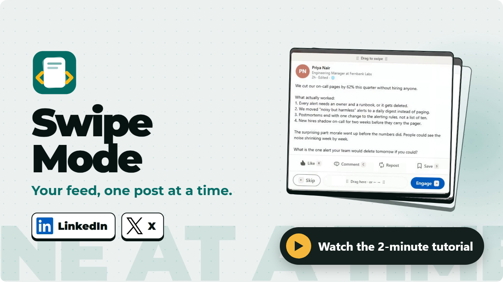

<p align="center">
  
</p>

<h1 align="center">Swipe Mode</h1>

<p align="center">
  <b>Your LinkedIn feed and your X timeline, one post at a time.</b><br>
  Skip left. Engage right. Every action stays your choice.
</p>

<p align="center">
  
  
  
  
  
</p>

<p align="center">
  <a href="https://cdn.jsdelivr.net/gh/prasannakulkarni2510/linkedin-x-chrome-extension@main/docs/media/swipe-mode-tutorial.mp4">
    
  </a>
  <br>
  <sub>▶ <a href="https://cdn.jsdelivr.net/gh/prasannakulkarni2510/linkedin-x-chrome-extension@main/docs/media/swipe-mode-tutorial.mp4">Watch the 2-minute tutorial</a>: install, every shortcut, LinkedIn and X.</sub>
</p>

<p align="center">
  <a href="https://cdn.jsdelivr.net/gh/prasannakulkarni2510/linkedin-x-chrome-extension@main/docs/media/swipe-mode-tutorial.mp4">
    
  </a>
  <br>
  <sub>▶ <a href="https://cdn.jsdelivr.net/gh/prasannakulkarni2510/linkedin-x-chrome-extension@main/docs/media/swipe-mode-tutorial.mp4">Watch the 2-minute tutorial</a>: install, every shortcut, LinkedIn and X.</sub>
</p>


https://github.com/user-attachments/assets/84857ef6-d1d7-4890-8d0d-12f9d434f0cb


---

## Why

Endless scrolling buries the posts you care about. Swipe Mode puts one post on a focused card, so
you read it, decide, and move on.

- **One post, the whole card.** Long posts scroll inside it. Promoted posts are left out.
- **You pick every action.** Swiping right opens a menu. Nothing is liked, posted or saved until you
  choose it.
- **Honest results.** An action counts as done only when the site confirms it. If it doesn't,
  Swipe Mode says so and marks nothing.
- **Human pace.** A pacing guard spaces out actions. Reading and skipping are never limited.

## Install

Swipe Mode is not on the Chrome Web Store. Install it from this repository:

1. **Get the code.** Click **Code → Download ZIP** above and unzip it, or clone it:
   ```bash
   git clone https://github.com/prasannakulkarni2510/linkedin-x-chrome-extension.git
   ```
2. Open `chrome://extensions` and turn on **Developer mode** (top right).
3. Click **Load unpacked** and choose the **`extension`** folder inside it (not the top-level folder).
4. Open your LinkedIn feed or `x.com/home`, then click the **Swipe Mode** button or press `Alt+Shift+S`.

To update, download again (or `git pull`), click reload on the Swipe Mode card in
`chrome://extensions`, and reload the tab. No `npm install` is needed to use it.

## Keys

Same keys on both sites; each does that site's version of the action.

| Key | LinkedIn | X |
| --- | --- | --- |
| `←` or `N` | Skip | Skip |
| `→` | Engage menu (never acts by itself) | Engage menu |
| `R` | React: then `1`–`6` (Like, Celebrate, Support, Love, Insightful, Funny), `0` removes | Like |
| `C`, then `Ctrl+Enter` | Comment | Reply |
| `S` | Save | Bookmark |
| Engage `3` / `4` | Repost / Repost with your thoughts | Repost / Quote |
| `O` | Open the post in a background tab | Open the post in a background tab |
| `U` | Undo the last skip (up to 20) | Undo the last skip |
| `↓` `↑` `Space` `PgDn` | Read further or back | Read further or back |
| `?` | Shortcuts for this screen | Shortcuts for this screen |
| `Esc` | Back one level; on the card, exit to where you started | Same |
| `X` | Exit and stay at this post | Same |

The engage menu's numbers never shift: `1` React · `2` Comment · `3` Repost · `4` Repost with
thoughts or Quote · `5` Save or Bookmark · `6` Open · `7` Copy link · `8` Author's profile.

**Trackpad:** two-finger swipe left to skip, right to engage. One swipe is one decision.
**Mouse:** drag the grip bar on top of the card, or the grip between Skip and Engage. Dragging
there never selects text. Long-press the card for the menu.

After an action succeeds, Swipe Mode waits 1.5 seconds before the next post. Press `Esc` in that
window to stay and do a second action, for example react, then comment.

## Settings

Right-click the toolbar icon, then **Options**:

- **Timing:** the wait after an action (0 to 4 s) and the pause before the next post.
- **Queue:** leave out promoted posts; show or hide the floating button.
- **Pacing guard:** the minimum time between actions and a cap per 10 minutes.
- **Diagnostics:** "Check my LinkedIn or X tab" shows what Swipe Mode can find on your open tab,
  and "Inspect page layout" copies a report with no post text. Nothing is sent anywhere.

## Before you use it

> [!WARNING]
> LinkedIn and X both restrict third-party tools that scrape, restyle or automate their sites, and
> accounts using them can be limited. Swipe Mode reads posts on the page, draws its own overlay, and
> clicks the site's own buttons only when you pick an action. Use it at your own risk, keep the
> pacing guard on, and get legal advice before publishing it.

Swipe Mode keeps nothing after you exit: no history, no account, no server. It is not affiliated
with LinkedIn or X.

## Status

| | |
| --- | --- |
| ✅ Tested | 89 unit tests and 46 end-to-end tests that load the real extension in Chromium against local mock feeds for LinkedIn (`dev/mock-feed`) and X (`dev/mock-feed/x`). |
| ✅ Real LinkedIn | Finding, reading and skipping posts (checked on 0.1.3). |
| ⚠️ Not yet checked live | LinkedIn reacting, commenting, saving and reposting on the 2026 layout; everything on real x.com. The mocks copy the sites' markup, so tests prove the code matches the mocks, not the live sites. |

If an action shows "Couldn't complete that" or "Couldn't confirm", nothing was claimed as done.
Run **Options → Inspect page layout** on that tab and adjust `extension/src/linkedin/selectors.js`
or `extension/src/x/selectors.js`.

<details>
<summary><b>Known limits</b></summary>

- On LinkedIn's 2026 layout, **Open** and **Copy link** are hidden: the page no longer exposes a
  post link Swipe Mode can read.
- Non-English LinkedIn: class-based selectors still work, but the English text fallbacks (menu
  names, toast messages) don't, so Save and Repost may show as "not confirmed".
- X: "Show more" opens the post page, so long X posts offer **Show more on X** (`O`) instead.
  Replies from the card are capped at 280 characters.

</details>

## Develop

```bash
npm install     # Playwright, for tests and icons
npm test        # unit tests (Node's built-in runner)
npm run e2e     # builds dev/.test-extension and runs the browser tests on the mock feeds
npm run serve   # mock feeds: LinkedIn at http://localhost:5173, X at /x/
npm run icons   # regenerate extension/icons
```

The test build (`dev/build-test-extension.js`) is a copy of `extension/` that also runs on
`localhost`. The shipped manifest only matches `www.linkedin.com` and `x.com`.

<details>
<summary><b>Project layout</b></summary>

```
extension/
  manifest.json
  src/core/        pure logic: ids, queue, keymap, gesture, pacing, catalog, settings, dom
  src/linkedin/    LinkedIn profile and every LinkedIn DOM assumption
  src/x/           X profile and every X DOM assumption (data-testid based), same file set
  src/ui/          shadow-DOM overlay and styles
  src/content/     controller: session, refill, input, results
  src/background/  toolbar button, shortcut, background tabs
  options/         settings and diagnostics page
dev/               mock feeds, test server and build, icon script
tests/unit, tests/e2e
docs/              product spec, decisions log, tutorial video
```

</details>

Built from the [product spec](docs/prd-v1.md). Choices the spec left open are recorded in
[`docs/DECISIONS.md`](docs/DECISIONS.md).
